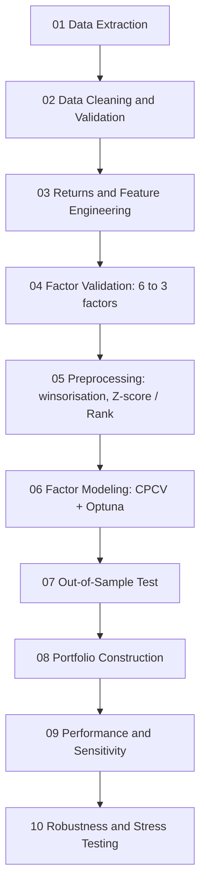

# Cross-Sectional Factor Model with Machine Learning + Portfolio Construction

An end-to-end quantitative research project on S&P 500 stocks: from raw data to a cross-sectional ML model that ranks stocks by their expected 21-day return, then to constrained portfolios with transaction costs, and finally to a series of robustness and stress tests that document what the evidence does and does not support.

---

## Executive Summary

### Objective

Build, from scratch and without shortcuts, a complete quantitative pipeline: data extraction and validation, factor engineering and selection, ML models validated with purged cross-validation, a frozen out-of-sample (OOS) test, portfolio construction with realistic constraints and costs, and a critical robustness analysis of the final strategy.

### Main Results

- **The signal has out-of-sample ranking content.** With only three factors (Momentum 12–1, Upside Volatility and log10 Amihud Illiquidity), Ridge, XGBoost and Random Forest reach a mean Rank IC of 0.0522, 0.0550 and 0.0546 on the OOS window, a hit rate of about 60% and a top-minus-bottom decile spread (D10−D1) of 2.8% to 3.75% per 21 sessions.
- **The best portfolio beats the market on a risk-adjusted basis, but takes much more risk.** The highest-Sharpe portfolio (Random Forest, long only, top 10%, signal weighting, 21-session rebalancing) reaches a CAGR of 89.75% and a Sharpe of 2.474, against 17.76% and 1.016 for S&P 500 buy and hold. Its maximum drawdown is −32.47% versus −18.90% for the index, and its beta is about 1.83.
- **Positive alpha, with caveats.** CAPM alpha with Newey–West errors is positive for all four candidate portfolios (38.04% annualised for the best one, p-value 0.0002), and the Deflated Sharpe Ratio stays around 0.95. However, block-bootstrap confidence intervals for the Sharpe ratio include zero, and the result vanishes when the best stock of each day is removed.
- **Clear limits.** Performance is concentrated in technology, exposure to the market is high (beta ≈ 1.84, 171% down-market capture), and the strategy loses more than the S&P 500 in the stress scenarios.

### Main Conclusion

The evidence is consistent with a genuine cross-sectional signal rather than a data-mining artifact, but it is not strong enough to call it proven. The strategy is a high-beta, long-only, concentrated portfolio, and the whole OOS window covers only 357 trading days of a single bullish regime. The project supports the signal as a research result; it does not support presenting the strategy as robust, defensive or ready for deployment.

---

## Table of Contents

1. [Project Description](#project-description)
2. [Repository Structure](#repository-structure)
3. [Methodology](#methodology)
4. [Dataset](#dataset)
5. [Feature Engineering](#feature-engineering)
6. [Machine Learning Models](#machine-learning-models)
7. [Portfolio Construction](#portfolio-construction)
8. [Backtesting](#backtesting)
9. [Evaluation](#evaluation)
10. [Robustness](#robustness)
11. [Main Results](#main-results-1)
12. [Installation](#installation)
13. [Usage](#usage)
14. [Limitations](#limitations)
15. [Future Work](#future-work)
16. [References](#references)
17. [License](#license)
18. [Contact](#contact)

---

## Project Description

### Problem

Given the stocks of the S&P 500, can we rank them every day by their expected return over the next 21 sessions using a small set of factors, and can that ranking be turned into portfolios that remain attractive after constraints and transaction costs? Equally important: how much of the result survives demanding robustness tests?

### Motivation

This is a self-taught, solo project. I am a physics student and I built it to get familiar, in a practical way, with both financial vocabulary and programming oriented to financial markets. I am looking for an internship in a quant-related role (for example risk validation) during the second semester of my final year, and this project is my way of showing what I can do beyond a standard STEM curriculum: designing a leakage-aware pipeline, questioning my own results, and documenting limitations as carefully as successes.

### Objectives

- Build a reproducible pipeline that goes from raw market data to a frozen OOS test and portfolio backtest.
- Select factors using several criteria (data quality, distribution, persistence, redundancy and predictive power), not a single metric.
- Evaluate models with cross-sectional metrics (Rank IC, ICIR, hit rate, deciles) and with purged, combinatorial cross-validation.
- Translate the ranking into portfolios with realistic constraints, turnover control and transaction costs.
- Stress the final strategy and report honestly what passes, what passes with caveats and what fails.

---

## Repository Structure

```
quant-portfolio-project/
│
├── data/
│   ├── model_results/
│   │   ├── final_model/
│   │   └── oof_predictions/
│   ├── portfolio_results/
│   ├── preprocessed/
│   ├── processed/
│   ├── raw/
│   └── universe_496.json
│
├── docs/
│   ├── 00_general_methodology.md
│   ├── 02_data_cleaning.md
│   ├── 03_feature_engineering.md
│   ├── 04_factor_validation.md
│   ├── 05_factor_preprocessing.md
│   ├── 06_factor_modeling.md
│   ├── 07_oos_test.md
│   ├── 08_portfolio_construction.md
│   ├── 09_portfolio_performance.md
│   ├── 10_robustness_stress_testing.md
│   ├── FACTOR_MODELING_THEORY.ipynb
│   ├── logbook.md
│   └── PIPELINE_ROADMAP.md
│
├── notebooks/
│   ├── 01_data_extraction.ipynb
│   ├── 02_data_cleaning.ipynb
│   ├── 03_feature_engineering.ipynb
│   ├── 04_factor_validation.ipynb
│   ├── 05_factor_preprocessing.ipynb
│   ├── 06_factor_modeling.ipynb
│   ├── 07_oos_test.ipynb
│   ├── 08_portfolio_construction.ipynb
│   ├── 09_portfolio_performance.ipynb
│   └── 10_robustness_stress_testing.ipynb
│
├── src/
│   ├── analysis/        (factor_diagnostics.py)
│   ├── data/            (download_data.py, validate_data.py)
│   ├── features/        (returns.py, momentum.py, volatility.py, liquidity.py)
│   ├── models/          (pipelines, training, tuning, evaluation, interpretability, metrics/)
│   ├── portfolio/       (constraints, mean_variance_opt, risk_parity, benchmarks, attribution,
│   │                     robustness, sensitivity, sector_sensitivity, superiority, ...)
│   └── preprocessing/   (factor_preprocessing.py)
│
├── poetry.lock
├── pyproject.toml
└── README.md
```

### Description of Each Folder

| Folder | Description |
|---|---|
| `data` | Raw, processed and preprocessed data, model outputs (out-of-fold predictions and final models) and portfolio results. Everything is git-ignored except `universe_496.json`, the frozen OOS universe, which can be downloaded from GitHub. |
| `docs` | One document per notebook with the theory, justification and decisions behind each step, plus the general methodology, the pipeline roadmap and a logbook. |
| `notebooks` | Ten numbered notebooks that follow the full pipeline. Each section contains theory and justification, code, an explanation of the output and the resulting decision. |
| `src` | Reusable functions organised by pipeline stage (data, features, preprocessing, models, portfolio and analysis). The notebooks import from here. |

---

## Methodology

### Complete Pipeline

The project has two parts. **Part 1 (notebooks 01–07)** goes from raw data to frozen models with OOS predictions. **Part 2 (notebooks 08–10)** turns those predictions into portfolios, evaluates them and stress-tests them.



### Dataset

**Asset universe.** Current constituents of the S&P 500 (503 tickers). Four tickers with no valid history (FDXF, HONA, Q, SNDK) are dropped at download, leaving 499. After the missing-value diagnostics, AMCR and SW are removed, and FERG is also removed because it only entered the index in August 2026. This leaves a **frozen universe of 496 assets**, stored in `data/universe_496.json`, so the OOS test does not depend on how Yahoo Finance changes its constituent lists over time.

**Time period.** The development period runs from 2010-01-04 to 2024-12-30, and the modelling dataset covers 2011–2024 (1,627,370 observations) because of the 252-session warm-up. The OOS window starts on 15 January 2025; the gap with the end of the development period corresponds to purge and embargo.

**Note on the OOS end date.** The reference OOS window for portfolio evaluation ends on **18 June 2026 and contains 357 trading sessions**. Data was downloaded with some extra margin beyond that date, which is common practice, and a few sections that have no repercussions outside themselves (for example the model-level ranking metrics of notebook 07) were computed on a slightly longer window. Every portfolio result in this README refers to the 357-session window.

**Data source.** Yahoo Finance.

**Downloaded variables.** Open, High, Low, Close, Adjusted Close and Volume. Adjusted Close is the basis for returns and factors.

**Quality checks.** 0 OHLC inconsistencies, 0 duplicate dates, 0 negative volumes and 0 internal NaNs in prices. 24 companies have at least one zero-volume day (kept and flagged). 419 assets have full coverage since 2010, and 80 start trading later.

> **Survivorship bias.** The universe is the *current* S&P 500 applied backwards to 2010, so it does not reflect the historical composition of the index. Companies removed from the index during the period are missing. This is an important methodological limitation and it is stated explicitly (see [Limitations](#limitations)).

### Feature Engineering

**Factors used.**

- **Momentum 12–1:** 252 sessions of history, excluding the most recent 21.
- **Upside Volatility:** the component of volatility associated with positive returns.
- **log10 Amihud Illiquidity:** 21-day rolling Amihud illiquidity, log-transformed because of its strong right skew.

**Feature selection.** Six candidates entered formal validation: Momentum 12–1, Short-Term Reversal, Rolling Volatility, Upside Volatility, Downside Volatility and Amihud Illiquidity. They were assessed on availability, missingness, distribution, outliers (1.5 × IQR rule), persistence (autocorrelation and cross-sectional rank stability), redundancy (cross-sectional Spearman correlation), multicollinearity (VIF) and predictive power (IC, ICIR, t-statistic).

The three volatility measures form a single cluster with a lot of shared information, so only Upside Volatility is kept. Short-Term Reversal loses its persistence quickly (rank stability close to zero at 21 sessions) and has a negative IC. log10 Amihud has the highest IC and ICIR. The exclusion of factors is therefore not based on IC alone but on the combination of all criteria.

**Preprocessing.** A global 252-session warm-up, cross-sectional winsorisation at P1–P99 for every date (about 7–8% of observations are clipped), and two alternative representations: cross-sectional Z-score and uniform rank in [−0.5, +0.5]. The target is the 21-day forward return, left **raw**: not winsorised, standardised or ranked.

### Machine Learning Models

**Models evaluated.**

| Model | Used |
|---|---|
| Linear Regression | Initial benchmark; excluded from optimisation (no comparable hyperparameters) |
| Ridge | Yes, final model |
| Random Forest | Yes, final model (added after the initial benchmark because of its computational cost) |
| XGBoost | Yes, final model |
| LightGBM | Evaluated and optimised; not in the final set |

**Temporal validation.** Combinatorial Purged Cross-Validation (CPCV) over 2011–2024, with 7 temporal blocks, 5 for training and 2 for validation in each fold, a 21-day purge and an 11-day embargo, producing 21 folds. The effective sample reduction caused by purging and embargo is only 1.31%.

**Model selection.** Every model was compared with both representations (Z-score and percentile rank) using a multi-criteria score (mean Rank IC 50%, Rank ICIR 30%, hit rate 20%). The score is relative to the candidates in the comparison and must not be read as an accuracy or a probability. Percentile rank worked better overall, and the three final models use it.

**Hyperparameter optimisation.** Optuna with a TPE sampler, maximising the out-of-fold mean Rank IC. Final models are trained on the whole development dataset, without repeating CPCV.

### Interpretability

**Feature importance.** Upside Volatility is the dominant variable in all three models (about 56–57% in Ridge and Random Forest, 43% in XGBoost). The order of log10 Amihud and Momentum differs only in Random Forest, and the importance ranking is preserved in the OOS period.

**SHAP.** For the tree-based models, SHAP summary and dependence plots are used to study the importance, direction and shape of the dependence of predictions on each factor.

### Portfolio Construction

**Signal generation.** The OOS predictions of the three models are ranked cross-sectionally every day and assigned to deciles. Ties are broken deterministically (`method="first"`), which matters because XGBoost produces only 285 distinct prediction values and Random Forest 4,680, against 182,612 for Ridge.

**Asset selection.** Two baselines (long only: decile 10; long-short: long decile 10 and short decile 1), plus a sensitivity analysis on the size of the selection (top 10%, 20% and 30%).

**Weighting schemes.** Three families: heuristic (equal weight and signal weighting), risk-based (inverse volatility and risk parity, both using 21-session volatility) and mathematical optimisation (Maximum Sharpe).

**Optimisation.** Maximum Sharpe has two stages: signal calibration from prediction to expected alpha (shape × scale decomposition with isotonic regression), and mean-variance optimisation with a 21-day covariance matrix shrunk with Ledoit–Wolf.

**Constraints.**

- Maximum weight per asset: 5%.
- Minimum effective weight per asset: 0.5% (applied independently to each leg in long-short portfolios).
- Rebalancing every 21 sessions with turnover control (target of about 30%, operational limit of 25% to leave room for the maximum and minimum weights that are reapplied afterwards).
- Buffer zones, applied only to the top 10% variants of inverse volatility and risk parity, where many positions sit close to the selection boundary (47.86% and 34.39% respectively).

Turnover accounts for market drift: existing weights evolve with the market before the rebalancing trades are computed. Before the controls, annualised turnover was very high (661% for Maximum Sharpe, 502% for risk parity, 389% for inverse volatility, 252% for equal weight and 237% for signal weighting), which motivated the turnover limit.

### Backtesting

**Assumptions.** 42 model–strategy combinations (three models over 14 unique portfolios), daily returns from 16 January 2025 to 18 June 2026 (357 sessions), 21-session rebalancing, market drift and constraints applied at every rebalance.

**Transaction costs.** 15 bps in the base scenario and 20 bps in the most demanding one, charged on turnover. At 15 bps the estimated annual cost ranges from about 0.30% (XGBoost long-short equal weight) to 1.14% (Random Forest long only top 30% Maximum Sharpe).

**Turnover.** The four main candidate portfolios have annualised turnover between 199% and 235%.

**Rebalancing frequency.** Frequencies of 5, 10, 21, 42 and 63 sessions were tested. 21 sessions has the best mean CAGR (38.74%) and mean Sharpe (1.584) among the alternatives and is used as the reference. This is an observation for this window, not proof that it is optimal in general.

---

## Evaluation

### Metrics

Four representative candidates, all rebalanced every 21 sessions and net of costs, against the S&P 500:

| Metric | S&P 500 (buy and hold) | Highest Sharpe | Highest CAGR | Highest Calmar | Baseline ML |
|---|---|---|---|---|---|
| Strategy | Benchmark | RF, long only, top 10%, signal weight | XGBoost, long only, top 10%, signal weight | XGBoost, long-short, equal weight | RF, long only, equal weight |
| CAGR | 17.76% | 89.75% | 81.63% | 32.51% | 72.42% |
| Annualised volatility | 17.49% | 36.28% | 35.35% | 14.53% | 32.85% |
| Sharpe | 1.016 | 2.474 | 2.309 | 2.237 | 2.205 |
| Sortino | 1.506 | 3.663 | 3.412 | 3.247 | 3.279 |
| Maximum drawdown | −18.90% | −32.47% | −32.37% | −12.85% | −30.45% |
| Calmar | 0.940 | 2.764 | 2.522 | 2.530 | 2.378 |
| Annualised turnover | 0.00% | 219.69% | 234.84% | 199.27% | 233.38% |
| Information ratio | – | 2.35 | 2.24 | 0.91 | 2.27 |

The four candidates represent different objectives: highest Sharpe, highest CAGR, highest Calmar (best return per unit of drawdown, and the shallowest drawdown of the four), and a baseline ML portfolio with equal weights that separates the effect of the model from the effect of the weighting scheme.

### Benchmarks

| Strategy | CAGR | Sharpe | Max. drawdown |
|---|---|---|---|
| S&P 500 buy and hold | 17.76% | 1.016 | −18.90% |
| Random selection (Monte Carlo, 500 portfolios) | 17.13% | 1.018 | −36.63% |
| Momentum top 10%, equal weight (no ML) | 55.56% | 1.763 | −23.70% |
| Momentum, signal weighting (no ML) | 63.68% | 1.879 | −26.03% |
| ML: RF long only, equal weight | 72.42% | 2.205 | −30.45% |
| ML: RF long only, top 10%, signal weight | 89.75% | 2.474 | −32.47% |

### Discussion

All four candidates beat the S&P 500, the momentum benchmarks and the random-selection benchmark in CAGR and Sharpe, but three of them suffer deeper drawdowns than the index. The ML baseline improves on equal-weight momentum while using less turnover (233% against 391%), and the signal-weighted ML portfolios beat signal-weighted momentum, which suggests that the models add value over a traditional momentum signal, with the caveat of a single, short window. Signal weighting adds value over equal weighting for the same model and selection, and Random Forest long only top 10% with signal weighting is the only candidate that beats its equal-weight counterpart in all three consecutive subperiods (early, middle and late).

Mean-variance optimisation does not beat the equal-weight baseline out of sample: the Sharpe ratios are 2.035 for equal weight, 1.463 for Maximum Sharpe, 1.324 for risk parity and 1.189 for inverse volatility. This does not mean that optimisation is useless in general; in this experiment, estimation error in expected returns and covariances, together with the operational constraints, probably prevents the optimiser from generalising. The CAGR also deteriorates when going from top 10% to top 30%, which points to a signal concentrated at the top of the ranking, and the long-short variant is the one that cushions drawdowns most clearly.

**Statistical evidence.** CAPM regression against the S&P 500 with Newey–West HAC errors (21 lags):

| Metric | Highest Sharpe | Highest CAGR | Highest Calmar | Baseline ML |
|---|---|---|---|---|
| Annualised alpha | 38.04% | 33.95% | 18.70% | 29.49% |
| Alpha t-stat | 3.78 | 3.35 | 3.14 | 3.46 |
| Alpha p-value | 0.0002 | 0.0008 | 0.0017 | 0.0005 |
| Beta | 1.827 | 1.792 | 0.588 | 1.702 |
| Beta t-stat | 20.81 | 22.71 | 6.47 | 22.46 |
| R² | 0.775 | 0.786 | 0.501 | 0.821 |

All four alphas are positive and significant at the 5% level under this specification, and the empirical p-value against the Monte Carlo random-selection benchmark is below 0.002 for the four candidates. The beta of the long-short portfolio is much lower (0.588), while the long-only portfolios carry a beta well above one. However, the circular block bootstrap of the Sharpe ratio (2,000 resamples, blocks of 21 sessions) produces wide 95% confidence intervals, from about −1.4 to 3.2, that include zero for the four candidates. The Monte Carlo test and the bootstrap answer different questions, but the width of the intervals shows that statistical precision is limited in a window this short.

---

## Robustness

Notebook 10 stress-tests the highest-Sharpe portfolio (Random Forest, long only, top 10%, signal weighting, 21 sessions). Each test is marked as passed, passed with caveats or not passed.

| Test | Result | Reading |
|---|---|---|
| Deflated Sharpe Ratio | Passed with caveats | Observed Sharpe of 2.47 against 1.04–1.10 expected by chance; deflated PSR of 0.945–0.953, only borderline. It depends on counting 210 or 42 trials. |
| Training window and prediction horizon | Passed | Positive in all six configurations (expanding and 5-year rolling window; 5, 10 and 21-session horizons). |
| Universe sensitivity (sectors) | Passed with caveats | Beats the sector benchmark in all four sectors, but with returns heavily concentrated in technology. |
| Removing the five best days | Passed with caveats | Sharpe falls from 2.474 to 1.479 and CAGR from 89.75% to 48.57%, still above the S&P 500 Sharpe of 1.016. |
| Removing the best stock of each day | Not passed | CAGR falls to 0.26% and Sharpe to 0.006. |
| Rolling beta, alpha and tracking error | Passed with caveats | Stable but high exposure: beta between 1.55 and 2.26 (mean 1.842) and alpha positive in most windows. |
| Stress resampling | Not passed | −38.83% against −33.49% for the S&P 500; the strategy beats the index in only 26.7% of scenarios. |
| Active drawdown | Passed with caveats | Maximum active drawdown of −18.15%, with up to 59 sessions below the benchmark. |

### Hyperparameter Sensitivity

A Random Forest with the already-optimised hyperparameters is retrained with an expanding window (2011–2024) and with a rolling five-year window (about 2020–2024), at prediction horizons of 5, 10 and 21 sessions, with rebalancing fixed at 21 sessions.

| Window | 5 days | 10 days | 21 days |
|---|---|---|---|
| Expanding | 2.574 | 2.487 | 2.360 |
| Rolling 5 years | 2.7998 | 2.651 | 2.534 |

The Sharpe ratio falls as the horizon grows, and the rolling window beats the expanding one at every horizon, so the result does not depend on using the full history since 2011. These are independent retrainings, so their numbers do not match the final model exactly, and the experiment does not show that the 5-day horizon is globally better, since risk, turnover and net costs would have to be compared under an identical protocol.

### Universe Sensitivity

The OOS window coincides with a strong technology rally, so portfolios are built within four sectors (top 20% of each sector, using the global Random Forest ranking filtered and re-ranked by sector, without retraining). Technology represents about 39.4% of the average weight of the main portfolio, with about 16 positions on average.

| Sector | CAGR | Benchmark CAGR | Sharpe | Benchmark Sharpe | Max. drawdown | Benchmark max. drawdown | Information ratio |
|---|---|---|---|---|---|---|---|
| Financial Services | 31.36% | 9.88% | 1.136 | 0.515 | −22.34% | −17.80% | 1.333 |
| Healthcare | 20.17% | 4.67% | 0.679 | 0.264 | −28.02% | −14.53% | 0.981 |
| Industrials | 51.00% | 19.55% | 1.627 | 0.962 | −29.33% | −20.39% | 1.665 |
| Technology | 146.99% | 36.76% | 3.063 | 1.401 | −37.45% | −25.93% | 2.337 |

The signal beats the sector benchmark in every sector, so it does not depend on technology alone, but the magnitude is very uneven and technology still contributes a disproportionate part of the result.

### Market Regimes

A formal regime test was not run: the OOS window contains essentially a single bullish regime, so splitting it would not have enough statistical power. Instead, the project looks at:

- **Temporal stability.** Sharpe ratios differ strongly across three equal subperiods (from about 0.7–0.9 in one to about 3.5–4.4 in another), and maximum drawdown ranges from about −8% to −23%.
- **Market capture.** Of the 357 sessions, 204 are positive and 153 negative. Up-market capture is 211.7% and down-market capture is 171.4%: the strategy amplifies both rallies and declines.
- **Stress resampling.** Synthetic years built from 21-session blocks drawn from the worst third of S&P 500 blocks (111 of 337 overlapping blocks, 2,000 scenarios of 12 blocks each), where the strategy loses more than the index.

Conditional bootstrap results (2,000 synthetic stress years; the stress threshold of 0.18% is the maximum S&P 500 return among the selected blocks):

| Portfolio | Mean synthetic CAGR | 95% CI | % of years profitable |
|---|---|---|---|
| S&P 500 (benchmark) | −33.49% | [−46.82%, −20.21%] | 0.0% |
| Highest Sharpe (strategy) | −38.83% | [−64.22%, −6.13%] | 1.2% |

The strategy outperforms the index in 26.7% of the stress scenarios, and its confidence interval is much wider than that of the benchmark.

---

## Main Results

### Tables

**Final OOS metrics of the models**

| Metric | Ridge | XGBoost | Random Forest |
|---|---|---|---|
| Rank IC mean | 0.0522 | 0.0550 | 0.0546 |
| Rank IC median | 0.0582 | 0.0573 | 0.0612 |
| Rank IC std (daily) | 0.2304 | 0.2035 | 0.2124 |
| Rank IC information ratio | 0.2264 | 0.2704 | 0.2573 |
| Rank IC hit rate | 59.68% | 60.48% | 60.48% |
| Rank IC t-statistic | 4.37 | 5.22 | 4.96 |
| RMSE | 0.1061 | 0.1061 | 0.1060 |
| MAE | 0.0748 | 0.0749 | 0.0750 |
| Decile Spearman | 0.7500 | 0.9667 | 0.8833 |
| D10−D1 | 2.8% | 3.75% | 3.75% |
| Unique predictions | 182,612 | 285 | 4,680 |

RMSE and MAE are practically identical across models, so they do not discriminate between them; the ranking metrics are the ones that matter for a cross-sectional strategy.

**OOS decile portfolio returns** (mean realised 21-day forward return of the stocks in each prediction decile)

| Decile | Ridge | XGBoost | Random Forest |
|---|---|---|---|
| 1 (lowest prediction) | 0.5890% | 0.3895% | 0.3785% |
| 2 | 0.4976% | 0.6659% | 0.8405% |
| 3 | 1.0799% | 0.8529% | 0.7445% |
| 4 | 1.0384% | 0.8215% | 0.6153% |
| 5 | 0.4861% | 0.8690% | 1.0470% |
| 6 | 1.3674% | 1.5837% | 1.4546% |
| 7 | 2.0897% | 1.3536% | 1.5949% |
| 8 | 1.7783% | 1.6612% | 1.4301% |
| 9 | 1.8020% | 1.7762% | 1.8734% |
| 10 (highest prediction) | 3.3948% | 4.1419% | 4.1288% |

Returns rise from the bottom to the top decile in all three models, and the top decile is clearly ahead (3.39% to 4.14%), but the middle deciles are not perfectly monotonic, which is why the decile Spearman is below one for Ridge and Random Forest. 

The Rank IC t-statistic is the naive mean / (standard deviation / √n), without correction for the overlap of 21-day horizons, so "statistically significant" should be read with care. The daily Spearman correlation between model rankings is 0.956 (XGBoost vs Random Forest), 0.882 (Ridge vs Random Forest) and 0.837 (Ridge vs XGBoost). The rolling Rank IC diagnostic shows no evidence of data leakage.

### Conclusions

#### What the Evidence Supports

- **The signal has ranking content in this sample.** The result is positive in all six window/horizon configurations, beats the sector benchmark in all four sectors tested, and survives the best-days test with a Sharpe of 1.48. The observed Sharpe (2.47) is well above the value expected by chance (1.04 to 1.10), although the deflated PSR (0.945 to 0.953) is only borderline.
- **It does not depend on one parameter choice or on technology alone.** Changing the horizon or the training window does not break the result, and the within-sector tests show that the signal works outside the sector that dominates the aggregate result.
- **Its exposure is stable.** Beta stays between 1.55 and 2.26 across 60-day windows and alpha is positive in most of them, so the performance is not the product of a single episode of high leverage on the market.
- **The finding does not depend on a single architecture.** Ridge, XGBoost and Random Forest all keep statistically positive ranking ability out of sample, with a monotonic relationship between predicted rank and realised return.

#### What the Evidence Does Not Support

- **The strategy is not defensive or market-neutral.** With a beta of about 1.84, it captures 171% of down-market moves and loses 38.8% in the synthetic stress year against 33.5% for the index. The capture asymmetry is consistent with a constant alpha added to high beta, not with convexity.
- **Breadth across holdings is not demonstrated.** Removing the best stock of each day eliminates essentially all of the return. The test is severe and uncalibrated, but it leaves the question open rather than answering it in the strategy's favour.
- **The absolute numbers should not be extrapolated.** A CAGR near 90% and a Sharpe near 2.5 come from 357 days of a single, strongly bullish regime, with return kurtosis close to 10.
- **Sophistication did not pay off in portfolio construction.** Mean-variance optimisation, risk parity and inverse volatility all had a lower Sharpe than the equal-weight baseline.

#### Overall Assessment

The evidence is consistent with a genuine cross-sectional signal rather than a data-mining artifact, but not strong enough to call it proven, and the way it is packaged is a high-beta, long-only, concentrated portfolio that will lose heavily in a prolonged market decline. This project supports the signal as a research result. It does not support presenting the strategy as robust, defensive or ready for deployment as a standalone product.

---

## Installation

The project requires Python 3.13 or later and uses [Poetry](https://python-poetry.org/) for dependency management.

```bash
# 1. Clone the repository
git clone https://github.com/PalaciosDaniel/quant-portfolio-project.git
cd quant-portfolio-project

# 2. Create the environment and install dependencies
poetry install
```

## Usage

Run the notebooks in order, from `01_data_extraction.ipynb` to `10_robustness_stress_testing.ipynb`:

```bash
poetry install --with dev
```

The `data/` folder is git-ignored, with the exception of `data/universe_496.json`. Raw data is downloaded again from Yahoo Finance in notebook 01 (and again in notebook 07 for the OOS test), using the frozen list of 496 tickers in the OOS stage. The `docs/` folder contains the theory and the justification of every decision, one file per notebook.

---

## Limitations

- **One OOS window for everything.** All the tests in the robustness notebook reuse the same 357 days. They measure sensitivity to design choices; they are not independent validation, and none of them observes a bear market.
- **Survivorship bias.** The universe is the current S&P 500 applied retrospectively to 2010, so companies that left the index are missing.
- **Short, bullish window with sector concentration.** The OOS period is about 18 months, in a single strongly bullish regime, and technology contributes a disproportionate part of the return.
- **The stress pool is thin.** It is built from the OOS window only, from heavily overlapping blocks, and its "stress" threshold is a slightly positive 21-day return.
- **The trial count in the DSR is a judgement.** The conclusion changes from just below to just above the 95% threshold depending on whether 210 or 42 trials are counted.
- **Several tests rely on approximations.** The cross-sectional test uses a cost proxy instead of actual transaction costs, and the Sharpe in the outlier tests is computed as CAGR divided by volatility, without a risk-free rate.
- **Simplified costs and capacity.** Costs are a fixed number of basis points on turnover, with no market impact, liquidity constraints or capacity analysis.
- **Single data source.** All data comes from Yahoo Finance.

## Future Work

- Rebuild the universe with the historical composition of the S&P 500 to remove survivorship bias.
- Extend the OOS window so that it covers several regimes, especially a prolonged bear market.
- Control market and sector exposure explicitly (beta-neutral or sector-neutral portfolios) to separate the signal from the market.
- Add more factors and model transaction costs more realistically (market impact and capacity).
- Correct the Rank IC t-statistic for the overlap of 21-day horizons.

## References

### Papers

- Bailey, D. H. and López de Prado, M. (2014). *The Deflated Sharpe Ratio: Correcting for Selection Bias, Backtest Overfitting and Non-Normality.*
- Amihud, Y. (2002). *Illiquidity and Stock Returns: Cross-Section and Time-Series Effects.*
- Jegadeesh, N. and Titman, S. (1993). *Returns to Buying Winners and Selling Losers.*
- Ledoit, O. and Wolf, M. (2004). *A Well-Conditioned Estimator for Large-Dimensional Covariance Matrices.*

### Books

- Hull, J. C. *Options, Futures, and Other Derivatives.*
- López de Prado, M. (2018). *Advances in Financial Machine Learning.*

### Documentation

- scikit-learn, XGBoost, LightGBM, Optuna, SHAP, statsmodels, yfinance.

---

## License

This project is released under the MIT License. See the [LICENSE](LICENSE) file for details.

---

## Contact

**Author**

- Name: Daniel Palacios Prieto
- LinkedIn: [daniel-palacios-prieto](https://www.linkedin.com/in/daniel-palacios-prieto-a65200322/)
- GitHub: [PalaciosDaniel](https://github.com/PalaciosDaniel)
- Email: dppeco2@gmail.com